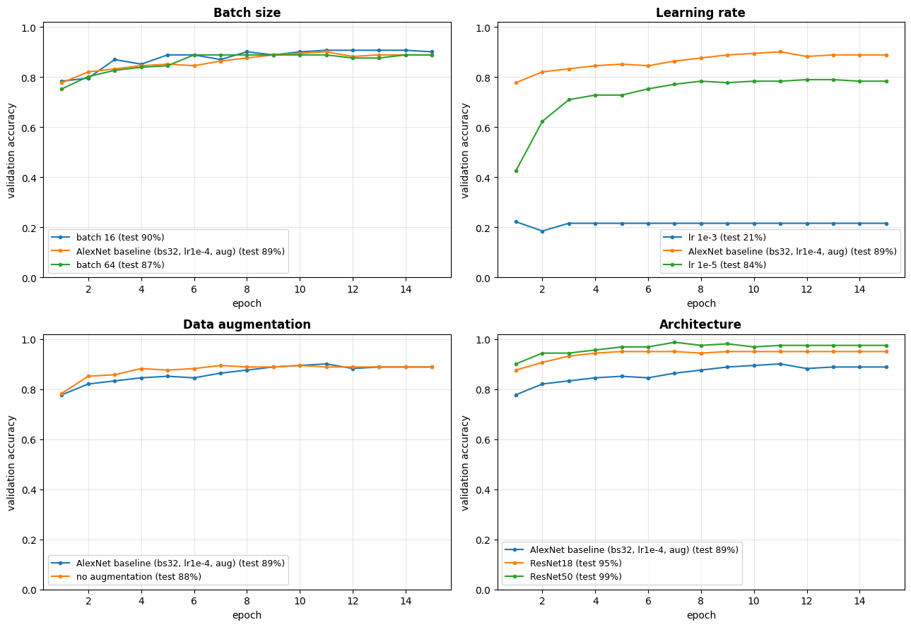

# PartSight: Identifying Marine Diesel Engine Parts with AlexNet

**Mathematics of Data Science · Final Project · Fall 2026 · Ziya Batur Koroglu**

PartSight classifies photos of six marine diesel / generator engine parts (fuel injector, turbocharger, piston, connecting rod, crankshaft, oil filter) using AlexNet with transfer learning, and compares it with ResNet18 and ResNet50.

🌐 **Website:** https://zkoroglu2024.github.io/PartSight/
▶️ **Live demo:** https://zkoroglu2024.github.io/PartSight/#demo (upload a photo; the ResNet50 model runs in your browser)
📓 **Colab notebook:** https://colab.research.google.com/drive/1Crwjur-RTCPTQIfSx77DgfwMhj61zDWP?usp=sharing

## Deliverables

| # | Deliverable | File |
|---|---|---|
| 1 | Presentation | [Slides (PDF)](deliverables/PartSight_Slides.pdf) · [PowerPoint](deliverables/PartSight_Slides.pptx) |
| 2 | Website + live demo | [index.html](index.html), served with GitHub Pages; the demo runs [model/partsight_web.onnx](model/partsight_web.onnx) in the browser |
| 3 | Colab notebook | [PartSight_AlexNet.ipynb](PartSight_AlexNet.ipynb) (with all outputs) |
| 4 | Scientific poster | [Poster (PDF)](deliverables/PartSight_Poster.pdf) · [PowerPoint](deliverables/PartSight_Poster.pptx) |
| 5 | Presentation video | YouTube link: *add after recording* · [Script](deliverables/PartSight_Video_Script.md) |

## Results (172 held-out test photos)

| Run | Change | Test accuracy |
|---|---|---|
| baseline | AlexNet, batch 32, LR 1e-4, augmentation | 89.0% |
| bs16 | batch 16 | **90.1%** (best AlexNet) |
| bs64 | batch 64 | 87.2% |
| lr1e-3 | learning rate 1e-3 | 20.9% |
| lr1e-5 | learning rate 1e-5 | 84.3% |
| no_aug | no augmentation | 88.4% |
| resnet18 | ResNet18 | 95.3% |
| resnet50 | ResNet50 | **98.8%** (best overall) |



## Method in brief
- **Data:** 60 web image searches (10 per part) gave 1,695 photos. Near-duplicates were removed, then CLIP filtered out off-topic photos and diagrams, leaving 1,101 clean photos split 70/15/15.
- **Model:** ImageNet-pretrained AlexNet with its last layer replaced by 6 outputs, fine-tuned with cross-entropy (label smoothing 0.1), Adam, a cosine learning-rate schedule and 15 epochs.
- **Tracking:** every run is logged to Weights & Biases.

## Repository layout
```
index.html                  project website (GitHub Pages)
PartSight_AlexNet.ipynb     Colab notebook with outputs
figures/                    charts and results from the notebook run
deliverables/               slides, poster (PDF + PowerPoint), video script
model/                      ResNet50 exported to ONNX (8-bit weights) for the browser demo
demo/examples/              example photos for the demo
```
